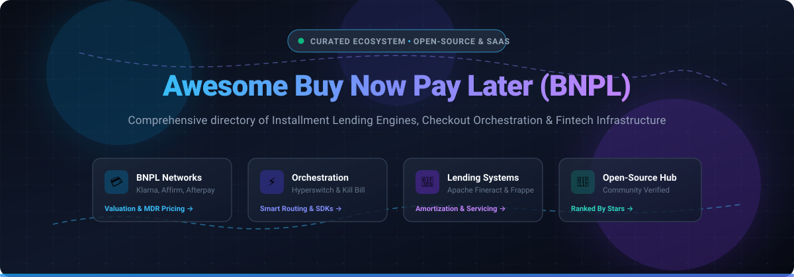

<div align="center">

# 🌟 Awesome Buy Now Pay Later (BNPL) 💳

<a href="https://github.com/ishandutta2007/Awesome-Awesome-Awesome"></a><a href="https://discord.gg/jc4xtF58Ve"></a>
<a href="https://github.com/ishandutta2007/Awesome-Buy-Now-Pay-Later-BNPL/stargazers"></a>
<a href="https://github.com/ishandutta2007/Awesome-Buy-Now-Pay-Later-BNPL/network/members"></a>
<a href="https://github.com/ishandutta2007/Awesome-Buy-Now-Pay-Later-BNPL/issues"></a>
<a href="https://github.com/ishandutta2007/Awesome-Buy-Now-Pay-Later-BNPL/blob/main/LICENSE"></a>
<a href="https://github.com/ishandutta2007"></a>

<br/><br/>

<a href="#table-of-contents">
  
</a>

<p align="center">
  <strong>Curated Directory of Open-Source Projects, SaaS Platforms, Lending Engines &amp; Payment Orchestration for Checkout Financing</strong>
</p>

<p align="center">
  <a href="#-sector-overview--market-dynamics">Sector Overview</a> •
  <a href="#-saashosted-platforms">SaaS Platforms</a> •
  <a href="#-open-source-github-projects">Open-Source Hub</a> •
  <a href="#-architecture--frameworks-for-custom-systems">Architecture</a> •
  <a href="#-star-history">Star History</a> •
  <a href="#-support--sponsor">Support</a>
</p>

</div>

---

## 📖 Table of Contents

- [📊 Sector Overview & Market Dynamics](#-sector-overview--market-dynamics)
- [☁️ SaaS/Hosted Platforms](#-saashosted-platforms)
- [💻 Open-Source GitHub Projects](#-open-source-github-projects)
- [🏗️ Architecture & Frameworks for Custom Systems](#-architecture--frameworks-for-custom-systems)
- [🤝 How to Contribute](#-how-to-contribute)
- [⚖️ Disclaimer](#-disclaimer)
- [📈 Star History](#-star-history)
- [💖 Support & Sponsor](#-support--sponsor)

---

## 📊 Sector Overview & Market Dynamics

The global **Buy Now, Pay Later (BNPL)** sector processes over **$560 billion** in annual transaction volume (Gross Merchandise Volume), with specialized software, APIs, and platform revenues projected to expand from **~$12.8 billion** toward **$67+ billion** by 2026 at a compound annual growth rate (CAGR) of **21%–30%**. 

The sector's market dynamics reflect an **oligopolistic core with broad operational fragmentation**:
- **Concentrated Core:** The top tier—comprising global leaders like PayPal, Block (Afterpay), Affirm, Klarna, and Zip—controls approximately two-thirds (~66%) of all BNPL transaction flows and credit issuance.
- **Fragmented Long-Tail:** The remaining market is intensely fragmented across regional domestic players (e.g., European and APAC specialists), verticalized niche lenders (medical, healthcare, dental, automotive, home improvement), and embedded finance orchestration layers.
- **Banking & Network Disruption:** Visa, Mastercard, and traditional commercial banks are increasingly deploying white-label installment rails directly into point-of-sale systems, challenging pure-play checkout apps.

---

## ☁️ SaaS/Hosted Platforms

The leading commercial BNPL platforms, ranked in descending order by parent company market capitalization / corporate enterprise valuation:

| Platform | 🏢 Enterprise Valuation / Revenue | 💳 Starting Pricing (MDR + Fixed) | ⏱️ Free Tier / Trial Limits | 🎯 Core Focus & Key Strengths |
| :--- | :--- | :--- | :--- | :--- |
| **[Shop Pay Installments](https://shop.app/)** (Shopify) | **~$215B** Market Cap<br/>_($11.6B+ FY revenue)_ | **5.0% + $0.30** per transaction<br/>_(standard tier: 5.0%–5.9% + $0.30)_ | **3-day free trial** on Shopify (store admin config enabled; live storefront checkout locked until plan active), followed by $1/mo promo for 3 months | Shopify's native installment experience powered by Affirm. Zero-friction checkout integration for millions of Shopify merchants without separate underwriting agreements. |
| **[PayPal Pay in 4](https://www.paypal.com/)** | **~$48B** Market Cap<br/>_($33.2B FY revenue)_ | **4.99% + $0.49** per transaction<br/>_(standard US Pay Later commercial rate)_ | **Free developer sandbox** account (full simulated Pay Later checkout flows, mock customer balances, standard developer API limits) | Seamlessly integrates installment options into standard PayPal Checkout buttons, instantly available across millions of PayPal-ready merchants globally. |
| **[Afterpay](https://www.afterpay.com/)** (Block) | **~$45B** Market Cap<br/>_($24.2B FY revenue)_ | **4.0% + $0.30** per transaction<br/>_(standard tier: 4.0%–6.0% + $0.30)_ | **Free developer sandbox** account (requires onboarding manager credentials; dedicated test portal with mock card simulation rules) | The premier installment brand for retail, fashion, and lifestyle e-commerce, offering high consumer brand recognition among Gen Z and millennial demographics. |
| **[Affirm](https://www.affirm.com/)** | **~$24B** Market Cap<br/>_($2.2B–$3.9B revenue)_ | **3.0% + $0.30** per transaction<br/>_(standard tier: 3.0%–6.0% based on term duration)_ | **Free developer sandbox** environment (unlimited API tests, $35 min cart / $30k mock limit, 10-minute auth token auto-expiration) | Enterprise lending engine offering flexible installment terms from Pay in 4 up to 36-month financing with transparent terms for high Average Order Value (AOV) retail. |
| **[Klarna](https://www.klarna.com/)** | **~$10B–$15B** Market Valuation<br/>_($3.5B+ revenue)_ | **3.29% + $0.30** per transaction<br/>_(standard tier: 3.29%–5.99% + $0.30)_ | **Free Playground sandbox** tier (instant self-serve test MID generation; rate limited to 5 req/sec for session creation, 50 req/sec general) | Global BNPL powerhouse and shopping discovery network featuring Pay in 4, Pay in 30 days, and long-term financing with massive international reach across the US and Europe. |
| **[Sezzle](https://sezzle.com/)** | **~$4.4B** Market Cap<br/>_(~$550M+ revenue)_ | **6.0% + $0.30** per transaction<br/>_(standard tier; optional $15/mo inactivity fee if volume < $300/mo)_ | **Free self-service developer sandbox** (unlimited mock payments via fixed test OTP `123123`; formal merchant approval required for live keys) | B Corp-certified installment financing engine focusing on consumer financial wellness, loyalty features, and flexible omnichannel splitting for SMBs and DTC brands. |
| **[Zilch](https://www.zilch.com/)** | **~$2.0B** Private Valuation<br/>_(£110M+ ARR)_ | **0% direct merchant fee**<br/>_(monetized via standard Visa interchange: ~1.5%–2.5% + ASPN advertising; consumer tiers up to £4.99/mo)_ | **Free forever consumer plan** (Zilch Standard: up to 5% cashback rewards on Pay Now, 6-week split terms; zero software fee for merchants) | Virtual card BNPL model operating directly over standard Mastercard/Visa payment rails, eliminating merchant integration friction via affiliate and ad-funded monetization. |
| **[Zip (Quadpay)](https://zip.co/)** | **~$1.8B USD** Market Cap<br/>_(A$2.17B cap, A$4.0B+ GMV)_ | **4.0% + $0.30** per transaction<br/>_(standard tier: 4.0%–6.0% negotiated by volume)_ | **Free developer sandbox** access (self-serve/direct request; test credentials with standard HTTP 429 rate limit throttling and simulated barcodes) | Leading international multi-tier installment lender operating across the US, Australia, and New Zealand, providing rapid merchant settlement and flexible split payments. |
| **[Sunbit](https://sunbit.com/)** | **~$1.1B** Private Valuation<br/>_(~$343M revenue)_ | **5.0% flat fee** per transaction<br/>_(standard tier: 5.0%–5.5% flat processing)_ | **Free interactive live demo** upon request (no public self-service sandbox; personalized 1-on-1 guided trial session with sales engineering) | Specialized point-of-sale BNPL and installment provider customized for service-heavy in-person industries, including auto repair, dental, veterinary, and optical practices. |
| **[Splitit](https://www.splitit.com/)** | **~$30M** Valuation<br/>_(~$10M–$13M revenue)_ | **1.5% + $0.30** per transaction<br/>_(standard tier: 1.5%–3.0% based on settlement plan)_ | **Free developer sandbox** account (full API and plugin mock environment with test credit card suite and decline simulation) | Installment infrastructure leveraging consumer credit cards' existing pre-authorized limits without requiring credit checks, new loans, or balance transfers. |

---

## 💻 Open-Source GitHub Projects

Curated open-source repositories relevant to BNPL checkout orchestration, loan management engines, installment calculation logic, and fee comparison tools. 

> Repositories are sorted in **descending order by GitHub star count**, featuring real-time stargazers badges:

### 1. **[Hyperswitch](https://github.com/juspay/hyperswitch)** [](https://github.com/juspay/hyperswitch/stargazers)
* **Description**: Open-source, high-performance payment orchestration platform written in Rust. It serves as the foremost open-source infrastructure layer for routing and unifying BNPL providers alongside credit cards, wallets, and local payment rails across 100+ processors.
* **Key Features**: Unified checkout SDK for web/mobile; intelligent smart-routing and auto-retry rules; automated reconciliation; disputes and chargeback handling; PCI-compliant vault.
* **Tech Stack**: Rust (backend), TypeScript & React (SDK / Web Dashboard).
* **Deployment**: Self-hosted (Docker Compose, Helm, AWS CDK) or managed Cloud.
* **Role in BNPL**: **Payment Orchestration Layer** — routes to Klarna, Affirm, Afterpay, and others; does not underwrite consumer credit directly.

### 2. **[Kill Bill](https://github.com/killbill/killbill)** [](https://github.com/killbill/killbill/stargazers)
* **Description**: Open-source enterprise billing and payment platform designed for complex recurring charges, milestone invoicing, and installment scheduling.
* **Key Features**: Highly modular plugin architecture; real-time event bus; multi-currency support; automated dunning and payment retry logic; flexible catalog for installment intervals.
* **Tech Stack**: Java, OSGi plugin system, MySQL / PostgreSQL.
* **Deployment**: Self-hosted (Docker, Kubernetes, AWS).
* **Role in BNPL**: **Subscription Billing & Invoicing Backend** — manages scheduled recurring installment chargebacks, retries, and invoice lifecycles.

### 3. **[Apache Fineract](https://github.com/apache/fineract)** [](https://github.com/apache/fineract/stargazers)
* **Description**: Enterprise-grade open-source core banking and digital financial services platform developed under the Apache Software Foundation.
* **Key Features**: Comprehensive loan origination and servicing; configurable amortization schedules; custom interest calculation methodologies; accounting integration; multi-tenancy.
* **Tech Stack**: Java, Spring Boot, MariaDB / MySQL.
* **Deployment**: Self-hosted (Docker, Kubernetes, On-Premise).
* **Role in BNPL**: **Enterprise Loan Ledger** — underpins the core loan servicing, interest calculation, and ledgering operations for scaled fintech lending.

### 4. **[Frappe Lending](https://github.com/frappe/lending)** [](https://github.com/frappe/lending/stargazers)
* **Description**: Official open-source loan management system built natively on top of the Frappe framework and ERPNext ecosystem.
* **Key Features**: Loan product configuration with customizable repayment schedules; loan application-to-disbursement lifecycle; collateral tracking; automated general ledger journal entries; delinquency processing.
* **Tech Stack**: Python (Frappe Framework), MariaDB / Postgres, ERPNext.
* **Deployment**: Self-hosted (Frappe Bench).
* **Role in BNPL**: **Loan Servicing Infrastructure** — records post-origination installment schedules, repayments, and accounting reconciliations.

### 5. **[Mifos X](https://github.com/openMF/mifos-x)** [](https://github.com/openMF/mifos-x/stargazers)
* **Description**: Complete reference distribution built on top of Apache Fineract, offering web applications, reporting plug-ins, and financial services management interfaces.
* **Key Features**: Front-office client management; loan repayment tracking; multi-currency banking; reporting modules for risk and portfolio health.
* **Tech Stack**: Angular, TypeScript, Java (Fineract API).
* **Deployment**: Self-hosted (Docker / Tomcat).
* **Role in BNPL**: **Financial Management Suite** — visual interface for portfolio monitoring and loan ledger administration.

### 6. **[Dashout](https://github.com/deve-sh/Dashout)** [](https://github.com/deve-sh/Dashout/stargazers)
* **Description**: Reference implementation of an end-to-end Buy Now Pay Later service exploring customer checkout splitting and backend ledger mechanics.
* **Key Features**: Merchant checkout integration flow; customer installment split calculator; basic transaction status tracking.
* **Tech Stack**: JavaScript / Node.js.
* **Deployment**: Self-hosted / Local development.
* **Role in BNPL**: **BNPL Service Prototype** — useful for developers learning checkout splitting workflows.

### 7. **[MPG](https://github.com/afu-it/mpg)** [](https://github.com/afu-it/mpg/stargazers)
* **Description**: Transparent fee comparison engine and developer tool tracking fees across 81+ payment gateways and BNPL payment providers, complete with a free JSON API and MCP server.
* **Key Features**: Automated fee comparison (FPX, cards, e-wallets, and BNPL channels); developer-friendly JSON API; MCP (Model Context Protocol) tool integration for AI agents.
* **Tech Stack**: Go / JSON.
* **Deployment**: CLI / API / MCP server.
* **Role in BNPL**: **Cost Observability & Intelligence** — benchmarks real-world merchant processing fees for installment providers.

### 8. **[bnpl_system](https://github.com/p4prathamesh/bnpl_system)** [](https://github.com/p4prathamesh/bnpl_system/stargazers)
* **Description**: Educational Buy Now, Pay Later system implementation modeling credit limits and repayment mechanisms.
* **Key Features**: User registration with credit allowance; purchase recording with installment breakdown (EMI); repayment tracking and late penalty calculation.
* **Tech Stack**: Python (Flask), MySQL.
* **Deployment**: Local test server.
* **Role in BNPL**: **Educational Proof-of-Concept** — demonstrates fundamental BNPL database schemas and interest/installment math.

### 9. **[django-react-iou-bnpl](https://github.com/mojtaba-arvin/django-react-iou-bnpl)** [](https://github.com/mojtaba-arvin/django-react-iou-bnpl/stargazers)
* **Description**: Full-stack installment loan management project utilizing an I.O.U.-based repayment model with merchant-assigned installment plans.
* **Key Features**: Private assigned installment plan model; dual admin panels for consumers and merchants; role-restricted authentication; micro-frontend architecture.
* **Tech Stack**: Python (Django), React.js, TypeScript.
* **Deployment**: Self-hosted.
* **Role in BNPL**: **Merchant-Assigned Plan Architecture** — demonstrates how independent merchants can assign credit plans to repeat buyers.

### 10. **[RPB Lending](https://github.com/info-rbp/rpb-lending)** [](https://github.com/info-rbp/rpb-lending/stargazers)
* **Description**: Fork and enterprise modernization of Frappe-based loan servicing and origination infrastructure.
* **Key Features**: Loan product management; disbursement schedules; delinquency classification; regression test coverage and permissions hardening.
* **Tech Stack**: Python (Frappe), ERPNext.
* **Deployment**: Self-hosted (Frappe Bench).
* **Role in BNPL**: **Hardened Loan Engine** — backend loan lifecycle management.

### 11. **[T_Cred](https://github.com/Tameem2004/T_Cred)** [](https://github.com/Tameem2004/T_Cred/stargazers)
* **Description**: Experimental Web3 Buy Now Pay Later architecture exploring decentralized installment financing.
* **Key Features**: Smart contract-based purchase splitting; installment escrow mechanics on blockchain testnets.
* **Tech Stack**: Web3, Solidity, JavaScript.
* **Deployment**: Testnet / Local EVM.
* **Role in BNPL**: **Web3 Concept** — experiments with trustless crypto installment payments.

---

## 🏗️ Architecture & Frameworks for Custom Systems

Building a production-ready BNPL solution requires coordinating three distinct software layers:

```
[ Consumer Checkout UI ]  <--->  [ Payment Orchestration Layer (e.g., Hyperswitch) ]
                                             |
                                             v
[ Credit Underwriting & Decisioning ] <---> [ Loan Management & Servicing Engine (e.g., Apache Fineract / Frappe) ]
                                             |
                                             v
                               [ Accounting, Dunning & Reconciliation (e.g., Kill Bill / ERPNext) ]
```

1. **Orchestration Layer**: Use **Hyperswitch** to route transactions across multiple commercial BNPL providers (Klarna, Affirm, Zip) and payment methods with intelligent fallback logic.
2. **Loan Engine**: Use **Apache Fineract** or **Frappe Lending** for interest calculation, amortization tables, and loan lifecycle management.
3. **Billing & Dunning**: Use **Kill Bill** to orchestrate automated recurring charge retries, dispute webhooks, and invoice generation.

---

## 🤝 How to Contribute

Contributions to expand this curated list are welcome! Follow these steps:

1. 🍴 Fork the repository.
2. ✍️ Add or update entries in `README.md` following the established table or markdown format.
3. 🔗 Include verified links to official documentation or source code repositories.
4. 🚀 Open a Pull Request with a clear explanation of your additions.

---

## ⚖️ Disclaimer

- This repository is a **community-curated index** intended for research, architectural planning, and educational purposes.
- Commercial BNPL systems handle consumer credit and payment card data, requiring strict compliance with global financial regulations (e.g., PCI-DSS, KYC/AML, FCRA, GDPR, CCPA, and consumer lending disclosure laws).
- **No turnkey open-source BNPL network exists.** True commercial BNPL requires balance sheet capital, regulatory banking charters, fraud insurance, and merchant settlement mechanisms.

---

## 📈 Star History

[](https://star-history.dera.page/#ishandutta2007/Awesome-Buy-Now-Pay-Later-BNPL&type=date&legend=top-left)

---

## 💖 Support & Sponsor

Thank you for exploring and supporting **Awesome-Buy-Now-Pay-Later-BNPL**! 🙏

If this project saved you research time, helped you evaluate fintech architectures, or proved useful to your team:
- ⭐ **Star this repository** on GitHub to help others discover it.
- 🍴 **Fork and share** the repo with colleagues and developers in fintech.
- ☕ **Buy me a coffee / sponsor the project**: You can sponsor future open-source development directly via the [GitHub Sponsors Dashboard](https://github.com/sponsors/ishandutta2007). Your support is deeply appreciated!

---

<div align="center">
  <sub>Maintained with ❤️ by <a href="https://github.com/ishandutta2007">Ishan Dutta</a>. Made for developers, fintech engineers, and merchants building transparent installment payment solutions.</sub>
</div>
